# SMART@Home walkthrough

How to use the **clinician view** and the **patient app**, with a 5-minute demo that connects them,
plus the **[3-minute hackathon pitch](#part-4-hackathon-pitch-3-min-demo--1-min-qa)** and
**[troubleshooting](#troubleshooting)**. Everything runs on synthetic patients; nothing here is medical advice.

| App | URL | Who uses it |
|---|---|---|
| Clinician view | http://localhost:8787/ | Care team, before and during a visit |
| Patient app | http://localhost:8787/patient/ | The teen at home, on their phone |

**Tip:** put the clinician view in a normal browser window and the patient app in a narrow window
(or Chrome DevTools → device toolbar, ⌘⇧M) side by side, so you can watch data flow between them.

## Setup

```bash
npm install
npm run build && npm start          # both apps on http://localhost:8787
```

- **AI (optional).** Copy `.env.example` to `.env` and set `ANTHROPIC_API_KEY` to use Claude
  (`claude-sonnet-5-5`, medium effort) for speak-mode check-ins and the Help chat. Without a key the
  app uses its built-in rule engine; every feature still works. `GET /api/ai/status` shows which is active.
- **Reset demo data** (clears patient entries, chats, uploads and clinician preferences):
  `curl -X POST localhost:8787/api/demo/reset`
- **Development** with hot reload: `npm run dev` (web on :5173, API on :8787).

---

## Part 1: Clinician view

### 1. Patient list (triage)

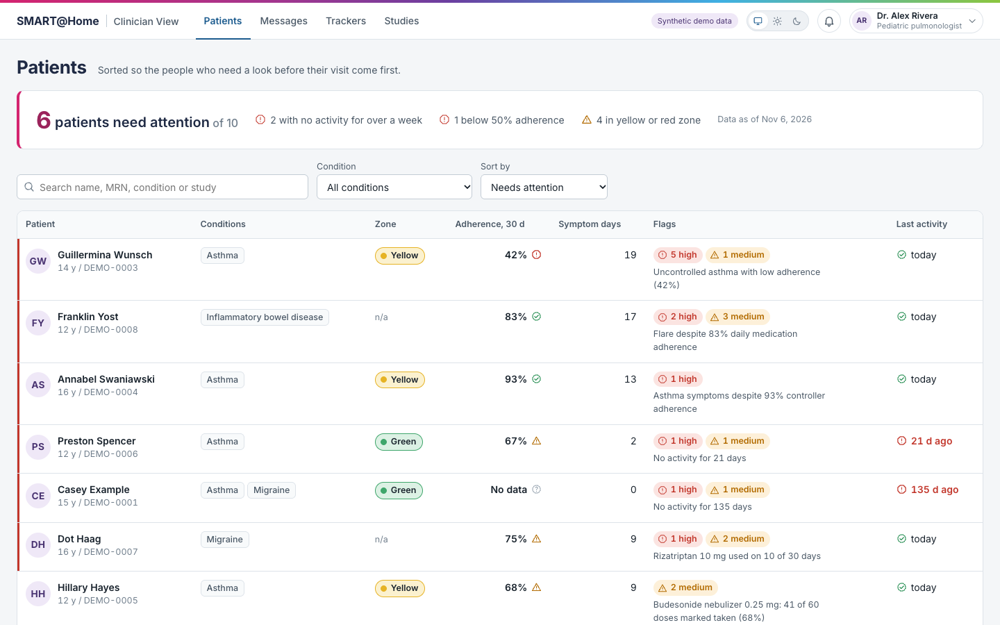

- You're signed in as **Dr. Alex Rivera (pulmonologist)**. Switch clinicians in the top-right menu;
  each has their own default view, layout and visit-mode settings.
- Patients are **sorted by who needs attention first**. The top three show the brief's key question,
  *treatment not taken vs. treatment not working*:
  - **Guillermina Wunsch:** uncontrolled asthma, only 42% of controller doses taken (not taken).
  - **Franklin Yost:** Crohn's flare despite taking his medicine.
  - **Annabel Swaniawski:** asthma symptoms despite 93% adherence (not working).
- **Preston** and **Casey** are flagged for no recent activity, so missing data isn't read as "fine".
  **Teressa** is a new patient. **Antony** is well controlled: no flags.
- Use the search box and condition filter. Click **Annabel** to continue.

### 2. Patient dashboard: the first 30 seconds

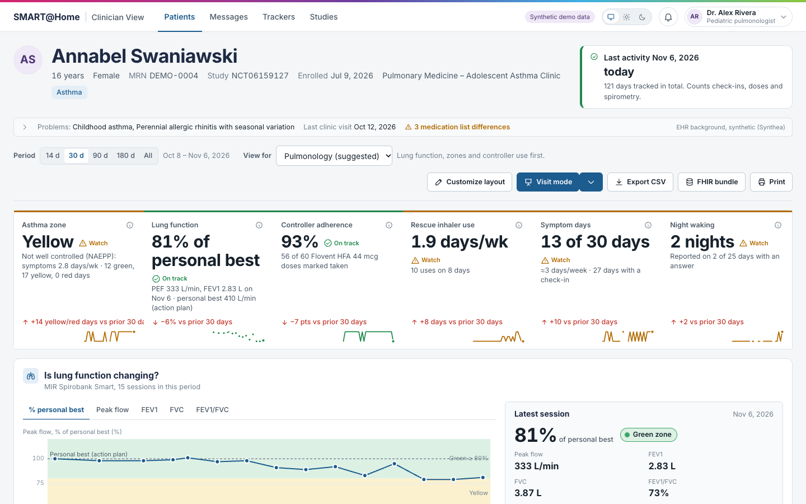

- **Header:** age, MRN, study, enrollment, and **last activity** across check-ins, doses and spirometry.
  The collapsed **EHR background** row shows the Synthea problem list, allergies and prescriptions,
  and flags differences between the EHR and the app's medication list.
- **Headline strip:** zone (with an NAEPP control assessment), lung function as % of personal best,
  controller adherence, rescue inhaler use, symptom days, night waking. Each card has a trend vs the
  previous period, a sparkline, and an ⓘ explaining exactly how it was calculated.
- **Period** (14 d · 30 d · 90 d · 180 d · All) and **View for** (Overview, Pulmonology, Primary care,
  Nursing, Neurology, Gastroenterology) change which metrics and sections appear, and in what order.

### 3. Going deeper

- **What needs attention:** clinical flags by severity. **Show N days on charts** highlights the dates.
- **Month at a glance:** a calendar colored by zone, hard days, symptoms, feeling or adherence.
  Days with no entry are hatched, so they never look like a good day.
- **Day drawer:** click any day on any chart.

  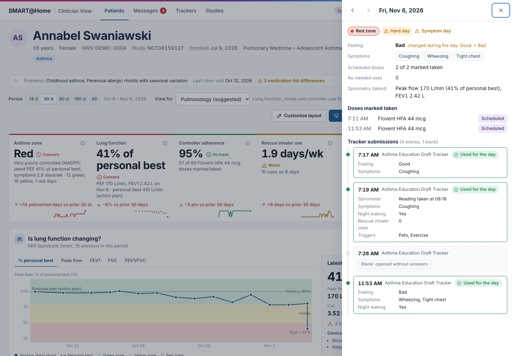

  It shows every submission (blank ones marked), which answer counted for the day (e.g. *Good → Bad*),
  doses, the latest spirometry session, photos, and a **Spoken check-in** badge with the transcript.
- **Day by day, in context:** feeling, symptoms, doses, rescue use, peak flow and zone on one shared
  date axis. A red ring marks days the patient said they felt fine but reported symptoms or low peak flow.
- **Is the medicine being taken?** Daily dose strips and weekly adherence per medication, with archived
  duplicates merged. If the patient stopped using the app, adherence is measured only up to their last
  activity, because not logging isn't the same as not taking.
- **Is lung function changing?** Spirometry trend with green/yellow/red zone bands, the latest session in
  clinical units (L, L/min, % of personal best), blow quality, and the device's coaching messages in
  plain English.
- **Asthma action plan**, **Tracker answers** (a chart for every question of every tracker, so migraine
  and IBD work too), and **Photos & videos** shared by the patient.

### 4. Customize layout (per clinician)

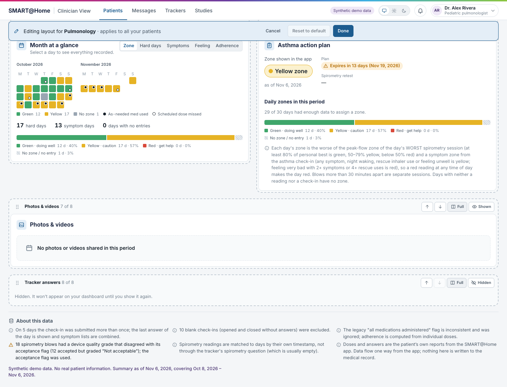

Click **Customize layout**. Drag sections or use ↑/↓, hide or show them, set full or half width, and
reorder the headline tiles. Click **Done**. The layout is saved to *your* profile for that view and
applies to **every patient** you open. **Reset to default** restores the preset.

### 5. Visit mode (with the patient in the room)

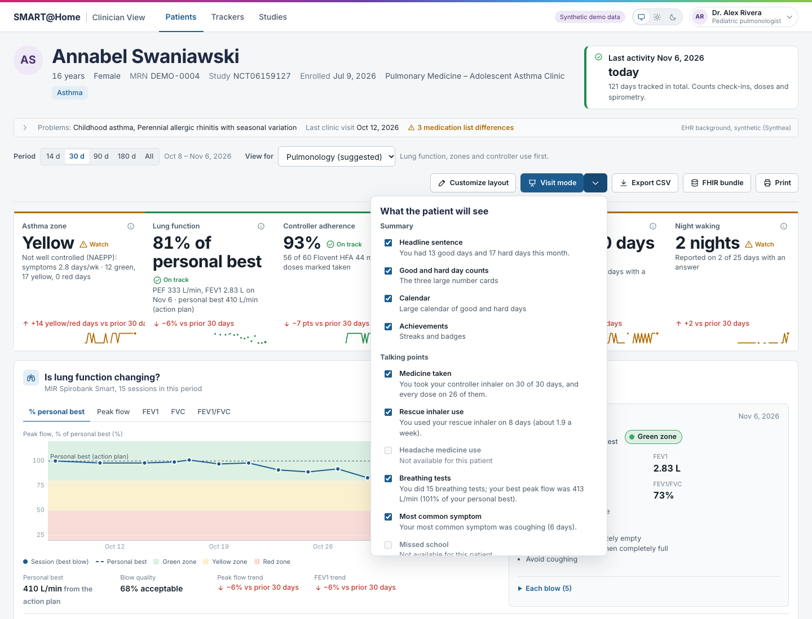

- Open **Visit mode ▾** → *What the patient will see*. Toggle the headline sentence, day counts,
  calendar, achievements, and each talking point (previewed with this patient's actual text).
  Choose **Save as my default** (all patients) or **Just this visit**.
- Click **Visit mode** to turn the screen around: large type, a big good/hard-day calendar, plain-language
  points, streaks and badges. There are no clinical flags or MRN, and no controls on screen.

### 6. Messages from the AI helper

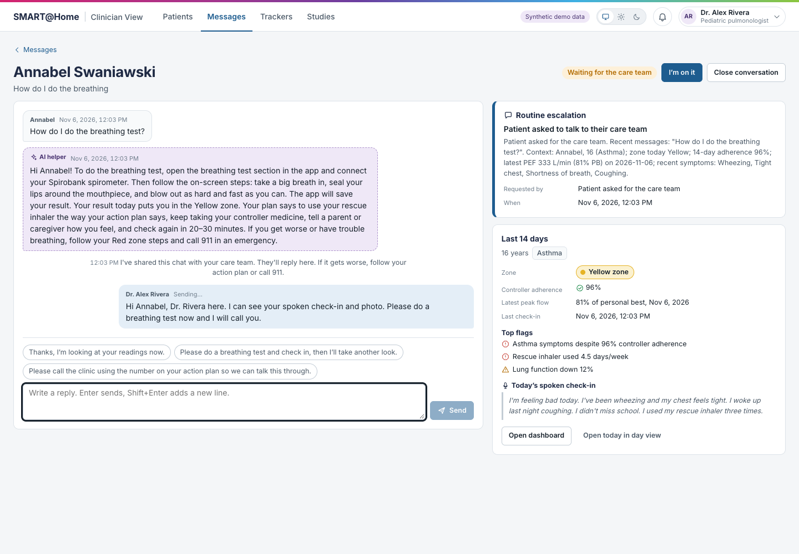

- The **bell** (with toasts) and the **Messages** tab show chats the patient's AI helper handed to the
  care team, sorted by urgency (urgent → soon → routine).
- A conversation shows the **full patient ↔ AI history**, the AI's summary for the clinician, and a
  14-day snapshot including today's spoken check-in. Click **I'm on it**, reply (Enter sends,
  Shift+Enter adds a new line), or **Close conversation**.

### 7. Other tools

**Export CSV** (one row per day) · **FHIR bundle** (the full record in Synthea-style FHIR R4: EHR
background, check-ins, doses, spirometry, media and chats) · **Print** · light/dark/system theme ·
**Trackers** tab (question types and roles) · **Studies** tab.

---

## Part 2: Patient app

### 1. Choose a patient

There's no login in the demo: tap **Annabel Swaniawski**. Switch later under **Me → Switch patient**.

### 2. Today

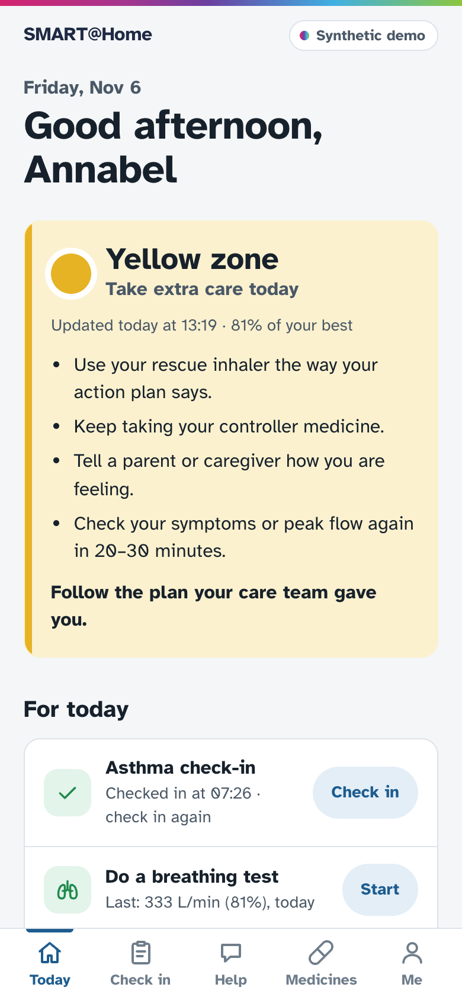

Zone card with the patient's action-plan steps, **Check in**, **Do a breathing test**, today's medicines
(**Mark taken** / **I used it**), streak, the last 14 days and badges.

### 3. Check in, two ways

- **Answer questions:** one question per screen, Skip anytime, review, then **Send check-in**.
- **Just talk** (for days when tapping through is too much):

  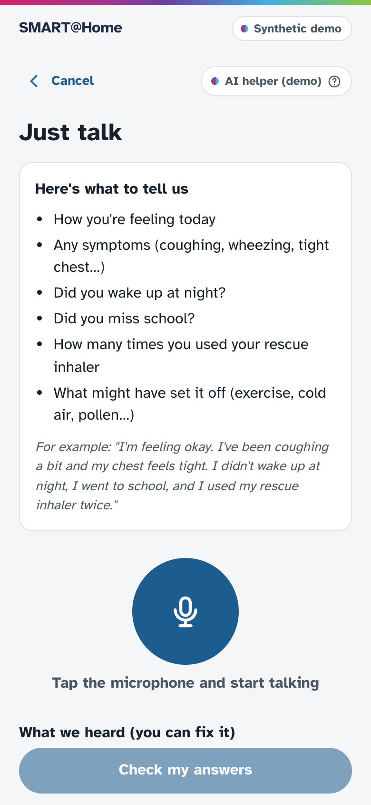

  1. Read *Here's what to tell us*, tap the mic and talk, or choose **Type it instead**. Example:
     *"Not great today, kind of rough. My chest is tight since gym class and I keep wheezing. Slept okay,
     went to school, used my albuterol twice."*
  2. Tap **Check my answers**. The form is filled in from what was said, each answer with a
     confidence label and a *You said: "…"* quote, plus a follow-up for anything missing.

     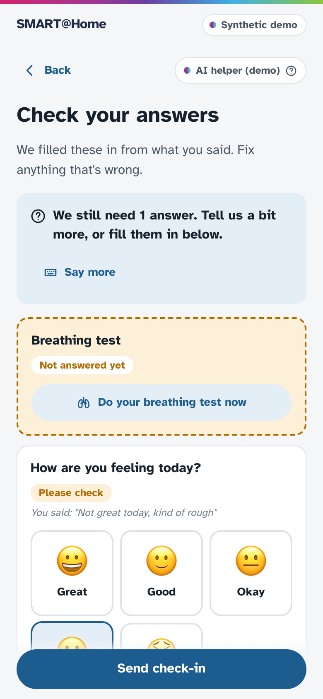

  3. Fix anything, optionally **Add photo or video**, and **Send check-in**.

### 4. Breathing test (simulated Spirobank)

Tap **Start**. The app pairs with the simulated MIR Spirobank, and you do 3 coached blows. Use
**Demo: simulate breathing** (Good / Okay / Struggling) to produce a green, yellow or red result.

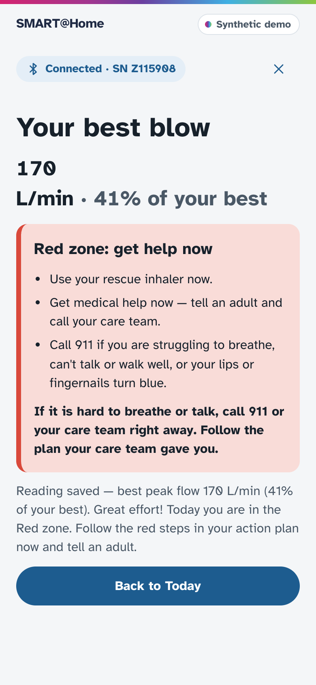

### 5. Help: AI helper first, then a person

- Tap a quick chip or type a question:
  - *"What zone am I in?"* gets a direct answer from the patient's own plan.
  - *"My Flovent makes my throat sore, can I stop it?"* gets no medicine advice; the helper shares the
    chat with the care team, and the banner shows *Waiting for your care team*.
- **Talk to my care team** asks for a person directly.
- When the clinician replies, it appears **live** in the chat.
- Emergency language skips the AI entirely: a **Call 911** card (988 for self-harm) and an urgent alert
  to the care team.

  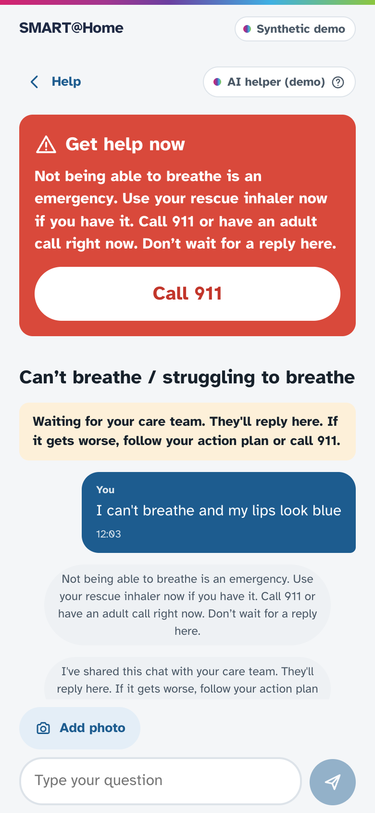

### 6. Medicines and Me

**Medicines:** today's schedule, the last 7 days, and as-needed use. **Me:** badges, **Photos & videos**
(upload, view, delete; only the care team sees them), theme, and Switch patient.

---

## Part 3: 5-minute demo of the full loop

1. **Patient (Annabel):** do a **Just talk** check-in and attach a photo. Then do a **Breathing test →
   Struggling** (red zone).
2. **Clinician:** refresh Annabel. The zone turns **Red** and lung function drops to about 40%. Click
   today on the calendar to see the **Spoken check-in** badge, transcript and photo.
3. **Patient:** in **Help**, ask whether you can stop Flovent. The helper hands off to the care team.
4. **Clinician:** the **bell** lights up. Open **Messages**, read the AI chat and summary, click
   **I'm on it** and reply.
5. **Patient:** the reply appears in the chat without refreshing.
6. **Clinician:** use **Visit mode ▾** to hide the rescue-inhaler point, then present **Visit mode**.
7. Reset the demo data.

The same flows are automated as browser tests (they need `npm start` running and reset data before
and after):

```bash
npm run e2e             # check-in, dose, breathing test → FHIR store → clinician view
npm run e2e:ai          # speak mode + photo, AI chat → escalation → clinician reply, safety screen
npm run e2e:clinician   # layout edit mode and visit-mode settings across patients
```

---

## Part 4: Hackathon pitch (3-min demo + 1-min Q&A)

**Judging criteria:** problem and impact · novelty · technical feasibility and depth · prototype
quality · pitch clarity · execution and judgment · Q&A · demo effectiveness.

**One-line pitch:** *SMART@Home already gets teens to log their asthma at home. We turned that raw log
into a two-minute pre-visit summary that tells a clinician whether the treatment isn't working or
just isn't being taken, and we made it easier for patients to send that data in the first place.*

### The 3-minute script

Roughly 25 s of story, 2 min 15 s of live demo and 20 s of depth. Say the **bold** lines word for word.
Everything else is what to click.

| Time | Say | Do | Criteria |
|---|---|---|---|
| **0:00–0:25** | **"Clinicians see 5 to 30 patients a day and look at home data in the minute before a visit. Today SMART@Home shows them this: one row per submission, 'Great' sitting next to wheezing, an empty spirometry column, and a 'last logged' date that's wrong. They can't tell if a treatment is failing or just not being taken."** | Show the brief's Screenshot 2 (PDF page 6, open in a tab), or say it if short on time. | Problem and impact |
| **0:25–0:45** | **"We built the view they asked for: triage first, the 30-second answer, then the evidence."** | Clinician tab → **Patients**. Point to Guillermina (*42% adherence, uncontrolled*) and Annabel (*93% adherence, still symptomatic*). **"Same disease, opposite actions: fix adherence versus step up therapy. We use NAEPP guideline thresholds and only measure adherence while the patient is actually using the app."** | Impact, judgment |
| **0:45–1:15** | **"Here's Annabel in 30 seconds."** | Open **Annabel**. Sweep the headline strip (zone, % personal best, adherence, rescue use). Click a day on the calendar → the **day drawer** (*"Good → Bad" in one day, the answer we counted, spirometry in L/min*). Switch **View for → Nursing** and back. | Prototype quality, depth |
| **1:15–1:50** | **"Now the patient side. When a teen feels awful, tapping through 7 questions is the last thing they'll do, so they can just talk."** | Phone tab → **Check in → Just talk** → speak, or paste the sentence below → **Check my answers**. Point to the pre-filled answers, the *"You said…"* quotes, and **Please check** on the uncertain one. **Send check-in.** | Novelty, demo |
| **1:50–2:30** | **"They can also ask a question. The AI helper answers from their own action plan, never gives medicine advice, and hands off to a person."** | Phone → **Help** → type *"My Flovent makes my throat sore, can I stop it for a week?"* → the helper declines to advise and escalates. Clinician tab → **bell** → conversation: full AI history, AI summary, today's spoken check-in in the snapshot → **I'm on it** → reply → **the reply appears on the phone live.** | Novelty, demo effectiveness |
| **2:30–2:45** | **"In the room, the clinician decides what the teen sees."** | **Visit mode ▾** → untick one talking point → **Visit mode**. | Judgment, prototype quality |
| **2:45–3:00** | **"It runs on SMART@Home's real data model: the same Cosmos JSON, built for any tracker (asthma, migraine, IBD). Everything is stored as Synthea-style FHIR R4, ready for Epic. Emergencies bypass the AI entirely, it falls back to rules if the AI is down, and it has 490 automated tests. We'd love to pilot it with the asthma study team."** | Optional: flash **FHIR bundle** or the safety card screenshot. | Feasibility, execution |

**Sentence to speak or paste for Just talk:**
> Not great today, kind of rough. My chest is tight since gym class and I keep wheezing. Slept okay,
> went to school, used my albuterol twice.

### Why each criterion is covered

| Criterion | What to point at |
|---|---|
| Problem and impact | The brief's own pain points: raw grid, missing spirometry, the wrong "last logged" date. Clinician research says they look right before visits and want summaries, adherence, and something to show patients. |
| Novelty | Speak-mode check-in → structured tracker answers with evidence quotes. An AI helper with a guaranteed human hand-off and full history. Clinician-controlled visit mode. Triage by *not taken vs not working*. |
| Technical feasibility and depth | Reads the real Cosmos schema (string values, repeated submissions, UUID-linked doses, archived duplicates). Tracker-agnostic question roles. NAEPP control rules. FHIR R4 storage with a lossless round trip. Synthea-seeded EHR context. SSE realtime. Claude with structured outputs, a deterministic safety screen and a rules fallback. |
| Prototype quality | Two working apps, live data flow, accessible (keyboard, screen-reader labels, color never the only cue), light and dark themes, phone-first patient UI. |
| Pitch clarity | One story (Annabel), one contrast (Guillermina vs Annabel), one loop (phone → clinician → phone). |
| Execution and judgment | Not logging ≠ not taking. A red reading is never hidden by a better one. No AI medicine advice. Emergencies skip the AI. Synthetic data only. The clinician controls what the patient sees. |
| Demo effectiveness | Every click is pre-planned, state is reset beforehand, and there are backups for every live dependency (below). |

### Likely questions (aim for 15-second answers)

- **How does this get into Epic?** Clinicians already open a SMART@Home tab in Epic. This view can be that tab (SMART on FHIR). We export the full record as FHIR R4 today. Per the brief, data flows one way and isn't written into the chart.
- **Privacy, HIPAA and AI?** The demo uses synthetic data only. In production the AI calls go through a HIPAA-eligible deployment under a BAA. Emergency detection is deterministic code that runs before any model, and with AI off, everything still works on the rules engine.
- **Are the flags clinically valid?** They follow NAEPP/EPR-3 impairment thresholds (symptoms or rescue use more than 2 days a week, night waking, % of personal best). Each metric shows exactly how it's computed. The next step is validating thresholds with the study clinicians.
- **Won't this cause alert fatigue?** Patients are sorted by attention score, data-quality issues are notes rather than flags, and the well-controlled patient has zero flags. Clinicians can also hide or reorder sections.
- **What if voice gets it wrong?** It never saves directly. The patient reviews every answer with a confidence label and the quote it came from, and the clinician sees the transcript next to the answers.
- **What stops the AI giving medical advice?** The system prompt forbids diagnosis and medicine changes. Escalation is a required tool call with a summary for the clinician. Red flags are caught by code before the model, and every hand-off keeps the full history.
- **Does it work beyond asthma?** Yes. The demo has migraine and IBD patients. Care teams tag questions with a role in the tracker builder (symptoms, pain, missed school…); every question gets a generic chart, and tagged ones feed the headline metrics and the neurology and GI views.
- **How much work to connect real data?** The analytics engine takes the existing per-patient Cosmos document unchanged, plus tracker definitions. The write path and FHIR mapping are already built.
- **Who answers the chats?** Each patient's care team. The nurse educator is always included as first responder, urgent chats sort to the top, and the AI summary saves a read-through.
- **What's next?** Usability sessions with the asthma study clinicians, an Epic SMART-on-FHIR launch, threshold validation, and patient consent for voice.

### Before you go on stage

- [ ] Run `npm run build && npm start`. Confirm http://localhost:8787 and http://localhost:8787/patient/ load.
- [ ] `curl -s localhost:8787/api/ai/status` shows `"engine":"claude"`. If the venue Wi-Fi is flaky, restart with `SMART_HOME_AI=off npm start` (rules engine, same flow).
- [ ] Run `curl -X POST localhost:8787/api/demo/reset` right before you present.
- [ ] Set up two windows: clinician full-width at 110–125% zoom, and the patient app in a Chrome window with DevTools device mode (iPhone 14) next to it. Pick **Annabel Swaniawski** on the phone ahead of time.
- [ ] Test the microphone in the room. If it fails, use **Type it instead** and paste the sentence above (keep it on the clipboard).
- [ ] Open the brief's Screenshot 2 in a background tab.
- [ ] Turn off notifications and sleep, plug in power, and set the display to mirror.
- [ ] Have the screenshots in `docs/images/` ready as a slide backup if the laptop or network fails.
- [ ] Rehearse with a timer. Cut the Nursing-view switch first, then the visit-mode step, if you're over 3 minutes.

---

## Troubleshooting

**Microphone / Just talk**

Speak mode uses the browser's built-in speech recognition. While listening, a **level bar** under the
mic moves when sound reaches the browser, and errors show a `(code: …)`.

| Symptom or code | Fix |
|---|---|
| Bar stays flat, or *"We can't hear you yet"* | macOS: System Settings → Privacy & Security → **Microphone** → turn your browser on, then restart it. Check System Settings → Sound → **Input**. |
| `not-allowed` | Allow the microphone from the lock icon in the address bar, then reload. |
| `network` | The browser blocks its speech service (Brave, Arc, some Chromium builds). Use **Google Chrome**, Edge or Safari. |
| `service-not-allowed` (Safari) | Turn on Dictation: System Settings → Keyboard → Dictation. |
| `insecure-context` | Voice needs `https://` or `localhost`. A phone opening `http://<your-ip>:8787` can't use the mic; demo on the laptop or serve over https. |
| Firefox | It has no speech recognition, so the app switches to typing automatically. |

**Other**

- **AI shows "Offline helper":** no `ANTHROPIC_API_KEY` in `.env`, or `SMART_HOME_AI=off`. Everything still works on the rules engine.
- **Port 8787 in use:** `pkill -f "tsx server/index.ts"`, or start with `PORT=8790 npm start`.
- **Demo state is messy:** `curl -X POST localhost:8787/api/demo/reset`.
